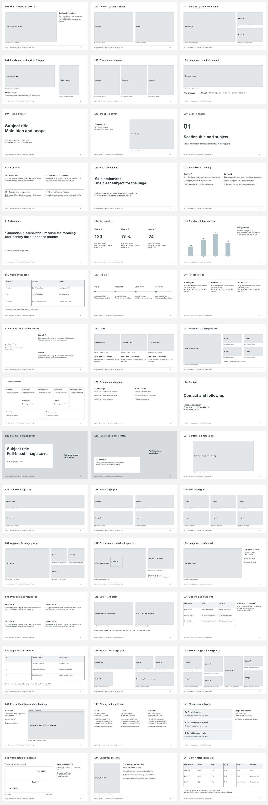

# Folio 原创横向线框

## 当前交付 v0.4

[45 项原创线框](wireframes.html) · [结构目录](wireframe-catalogue.md) · [逐页 QA 与评估](qa-all-pages-v0.4.md) · [修复记录](qa-v0.4.md)。

本目录只发布原创结构和验证记录，不发布参考清单或逐页研究对照。研究资料已在本地归档；Git 历史未改写，旧提交仍可能包含这些记录。

## 验证状态

HTML 的 `node validate-wireframes.cjs` 检查通过；HTML 实际截图、窄屏及转换输出验收尚未完成。下方独立原生 PPTX/PDF 的检查状态另列，不能视为 HTML 的验收。这里是研究实验，不替代正式布局预览，也不包含第三方模板资产。

## English Native Editions / 2026-10-11

[Editable PPTX / 45 pages](native-formats/folio-45-native-en-v1.pptx) · [PDF / 45 pages](native-formats/folio-45-native-en-v1.pdf)

These independent 16:9 native constructions retain L01-L45 and layout intent, but are not HTML conversions or exact replicas. All native pages were rendered for review; PDF text-fit and PPTX package/geometry checks passed. Four editable native tables and one native chart are included. Text, images and numbers are placeholders; application rendering in PowerPoint, Keynote and Google Slides remains unverified. The HTML validation limitations above are unchanged. Local Chinese editions and build records remain preserved outside this release.

